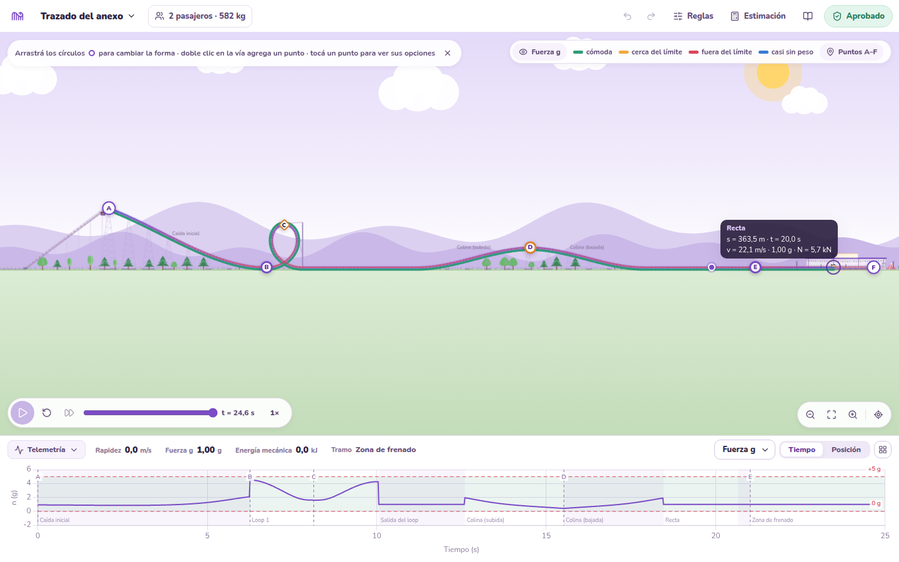
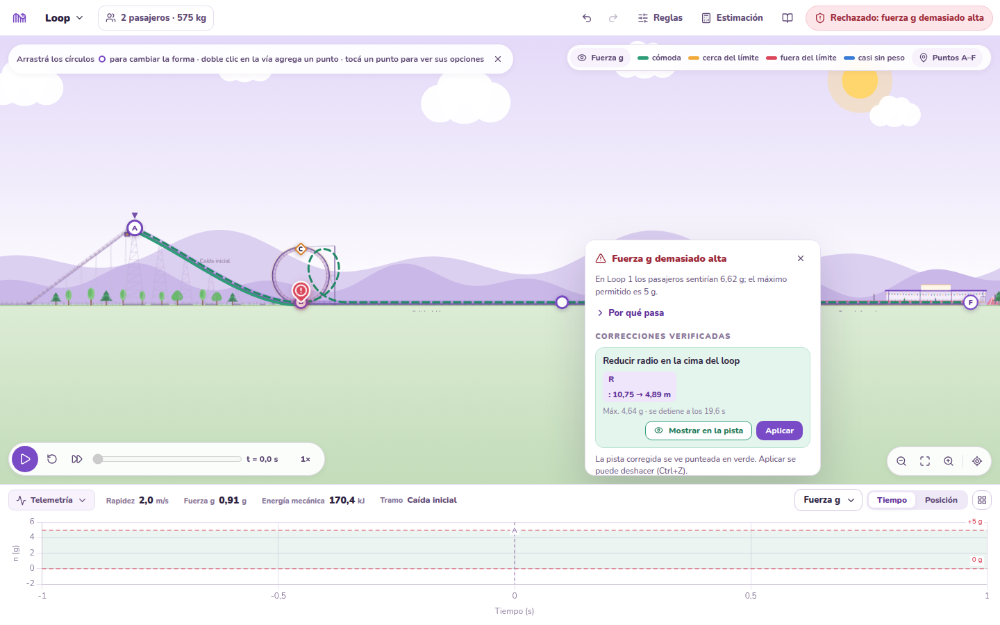
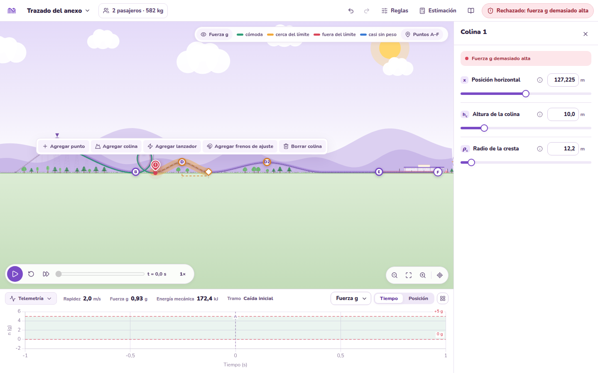
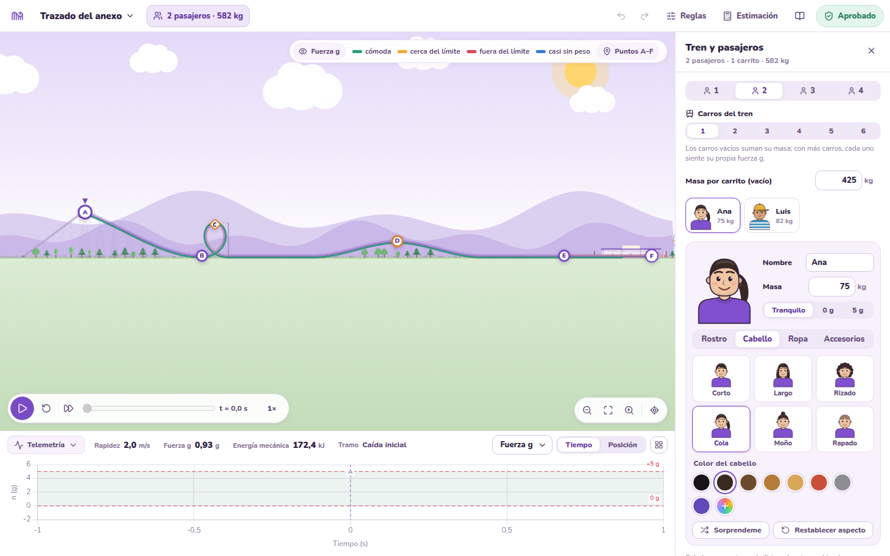
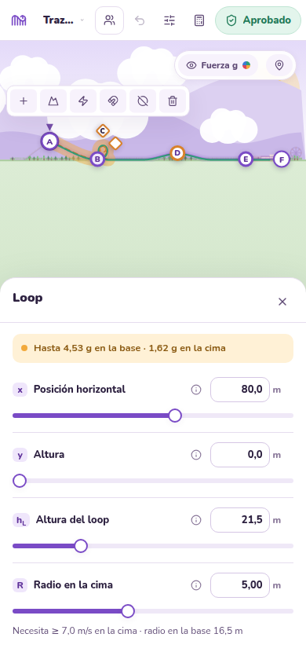
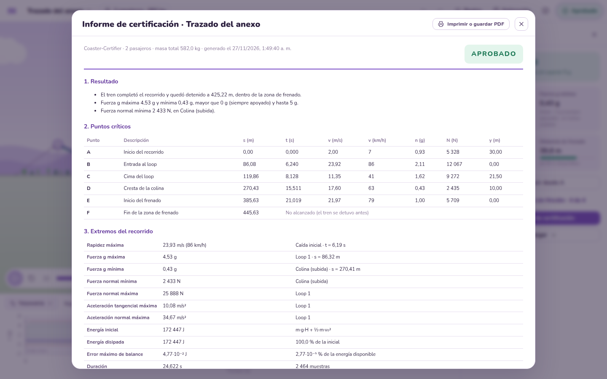

# Coaster-Certifier

**Certificador de montañas rusas**: simulador web con librería de física propia, pruebas de validación analítica, dictamen de aprobación o rechazo y ejecución *headless* con exportación a CSV.

Proyecto de Simulación · Física I (FUN-18) · Universidad CENFOTEC · 2026-C3 · **Grupo A**: Alejandro Soto Víquez, Dylan Josué Chaves Hernández y Minor Andrés Mora Vargas. Docente: Andrés Castro Núñez.

- **Aplicación desplegada:** https://coaster-certifier.vercel.app
- **Repositorio público:** https://github.com/alestooo/Coaster-Certifier



| Correcciones verificadas sobre la vía | Edición por elementos |
| --- | --- |
|  |  |

| Tren y pasajeros | En el teléfono |
| --- | --- |
|  |  |

---

## 1. Comandos

| Acción | Comando |
| --- | --- |
| Instalar dependencias | `npm install` |
| Ejecutar las pruebas (unitarias + validación analítica) | `npm test` |
| Pruebas con informe de cobertura de la librería | `npm run test:coverage` |
| Ejecución *headless* (escribe `output/certification.csv` y `output/certification.summary.json`) | `npm run headless` |
| *Headless* con otro escenario / paso / carpeta | `npm run headless -- --scenario valley --dt 0.005 --out salida` |
| *Headless* con una configuración propia en JSON | `npm run headless -- --config mi-trazado.json` |
| Listar los escenarios de referencia | `npm run headless -- --list` |
| Pruebas de extremo a extremo en Chrome (Playwright, usa el Chrome instalado) | `npm run e2e` · `npm run e2e:headed` |
| Servidor de desarrollo | `npm run dev` |
| Compilar para producción | `npm run build` |
| Verificación de tipos (Svelte + JSDoc) | `npm run check` |

Requiere Node.js ≥ 18.17. No usa ningún motor físico de terceros: toda la física está en `src/physics/`. La interfaz utiliza Svelte y Chart.js, además de lucide-svelte para iconografía. Ninguna de ellas se emplea como motor físico.

## 2. Estructura del repositorio

```
src/physics/                 ← LIBRERÍA DE FÍSICA (pura, determinista, sin DOM)
  index.js                   API pública (re-exporta todo lo documentado abajo)
  constants.js               g, límites del anexo, parámetros numéricos
  config.js                  DEFAULT_CONFIG, CONFIG_LIMITS, resolveConfig(), ConfigError
  scenarios.js               escenarios de referencia con dictamen esperado
  track/                     geometría: Hermite, loop en lágrima, plano inclinado, colina, buildTrack(), geometryAt()
  dynamics/                  kinematics.js (fórmulas elementales), forces.js, energy.js
  integration/               rk4.js, step.js (createInitialState, step) con localización de eventos
  evaluation/                criteria.js (incumplimientos), summary.js (extremos, tramos, puntos A–F), verdict.js (dictamen)
  export/csv.js              toCsv() — compartido por el script headless y la interfaz
  recommendations/           búsqueda verificada de alternativas que aprueban
  run.js                     runSimulation(): recorrido completo + dictamen
tests/                       vitest: analytical, track, config, engine, scenarios + ayudas de la interfaz (auditoría, manijas, cámara, sesión)
tests/e2e/                   Playwright: flujo completo del taller en Chrome
scripts/headless.js          ejecución sin interfaz → CSV + JSON + reporte en consola
src/ui/                      renderizado Canvas 2D (renderer/), gráficas Chart.js (charts/), exportación
src/components/, src/screens/, src/lib/, src/game/   interfaz Svelte 5 (consume la librería; nunca implementa ecuaciones)
docs/                        arquitectura y borrador de la entrega
```

La interfaz consume la librería; la librería no sabe que la interfaz existe. Si se borra `src/ui`, `src/components`, `src/screens` y `src/lib`, `npm test` y `npm run headless` siguen funcionando.

## 3. Modelo físico

Tren modelado como **partícula de masa m** (o, con `trainCars` > 1, como tren articulado de N carros: ver §8) sobre una **vía rígida en un plano vertical**, descrita por la coordenada de recorrido `s` (m), la inclinación de la tangente `θ(s)` (rad, positiva subiendo) y la curvatura con signo `κ(s) = dθ/ds` (1/m, positiva en valles y loops, negativa en crestas). Gravedad uniforme `g = 9,81 m/s²`. Unidades del SI en toda la librería.

**Segunda ley de Newton** en el sistema intrínseco (tangente, normal):

```
m·dv/dt = −m·g·sin θ − f − F_aire − F_freno − F_ajuste + F_lanzador + F_resorte + F_amortiguador   (tangencial)
N       = m·(g·cos θ + κ·v²)                                              (normal)
```

| Magnitud | Expresión | Función |
| --- | --- | --- |
| Fuerza g sobre los pasajeros (factor de carga, g) | `n = N / (m·g) = cos θ + κ·v²/g` | `loadFactor` |
| Fricción efectiva (rodadura; también aire si C_dA = 0) | `f = μ·|N|`, opuesta al movimiento (estática cuando v = 0) | `frictionMagnitude`, `resistiveForce` |
| Resistencia del aire | `F = −sign(v)·½·ρ·C_dA·v²` (ρ = 1,2 kg/m³, C_dA = 0 por defecto); con un carro, en la zona de frenado se integra en forma cerrada con `dv/dt = −(a_f + μg + k·v²)` | `airDragForce` |
| Frenos en la recta final | desaceleración constante `a_f` entre E y F; `d_det = v_E²/(2·a_f)`, `t_f = v_E/a_f` | `brakingDistance`, `brakingTime` |
| Resorte de frenado | `F = −k·x`, `E_e = ½·k·x²`; amortiguador opcional `F = −c·v` | `springForce`, `damperForce`, `elasticEnergy` |
| Lanzador LSM | `F = min(m·a_máx, P/|v|)` hacia adelante dentro de su tramo (m·a_máx en reposo); trabajo ideal sobre plano sin pérdidas: fuerza constante hasta `v₁ = P/(m·a_máx)` y después `v³ = v₁³ + 3·(P/m)·Δs` | `boosterForce`, `boosterWork` |
| Frenos de ajuste | `F = −c·v` dentro de su tramo (corrientes parásitas; con el tren articulado, c por cada carro que está adentro); en plano sin fricción `v(s) = v₀ − (c/m)·s` (N carros adentro: `N·c/m`) | `calculateForces` |
| Subida por cadena | no forma parte del recorrido evaluado (t = 0 en A); largo `H/sin α`, tiempo `L/v_c`, potencia del motor `P = (m·g·sin α + μ·m·g·cos α + ½·ρ·C_dA·v_c²)·v_c/η` | `liftMetrics` |
| Energías | `E_c = ½·m·v²`, `E_p = m·g·y`, `E_m = E_c + E_p + E_e`, `E_m(t) + E_dis(t) = E_m(0) + W_entrada(t)` | `calculateEnergies` |
| Energía disipada y de entrada | `dE_dis/dt = |f·v| + |F_freno·v| + |F_amort·v| + |F_aire·v| + |F_ajuste·v|`; `dW_entrada/dt = F_lanzador·v`, integradas junto con el movimiento | `step` |
| Contacto en la cima del loop | `N > 0 ⇔ v_C² > g·R` | `loopTopMinimumSpeed`, `evaluateState` |

**Geometría del trazado**

- Tramos entre nodos: polinomios cúbicos de **Hermite** y(x) con pendientes ajustadas para conectar tramos; existe continuidad de posición y tangente, pero no se garantiza continuidad de curvatura entre segmentos. La coordenada `s` se obtiene de una tabla de longitud de arco de 400 muestras por tramo.
- **Loop en lágrima**: familia con radio de curvatura `ρ(θ) = R_ref·(1 + c·cos θ)`. El usuario fija la altura `h_L` y el radio en la cima `R` (como en el anexo): `R_ref = h_L/2`, `c = 1 − 2R/h_L`, radio en la base `R_B = h_L − R`, longitud `2π·R_ref`, salida desplazada `π·c·R_ref`. Con `R = h_L/2` el loop es circular. Debe cumplirse `h_L ≥ 2R`.
- **Colina** de altura `h_c` y radio de curvatura en la cresta `ρ_c`: dos tramos de Hermite de semiancho `w = √(6·h_c·ρ_c)`, de modo que `ρ_c = w²/(6·h_c)` exactamente.
- **Plano inclinado**: recta de A al suelo (caso con solución cerrada, usado en las pruebas).
- **Lanzador y frenos de ajuste**: rectas horizontales entre dos nodos; como los tramos de Hermite llegan horizontales a sus nodos, no hay quiebres. Sin subida por cadena (montaña rusa lanzada) el primer tramo puede ir en plano.
- Tras el último nodo: aproximación horizontal de 8 m y zona de frenado de longitud `d_f`.

**Método numérico**

- Integrador **Runge–Kutta 4** sobre el vector `[s, v, E_dis, W_lanzadores, W_cadena]` con paso ≤ `maxSubstep` (0,001 s por defecto, como propone el anexo) y ≤ 0,03·√(m/k) (≈ 0,5 % del período del resorte).
- **Localización de eventos por bisección** (35 iteraciones): puntos de retorno `v = 0`, entrada exacta a la zona de frenado, fin de la zona, retorno al inicio y los bordes de cada lanzador y frenos de ajuste (en los dos sentidos). El paso que llega a un borde se integra con la fuerza del lado donde está el tren. Con un carro, los frenos de estación se integran de forma cerrada (MRUA, o `dv/dt = −(a + k·v²)` con aire) desde la entrada exacta; con el tren articulado, con RK4 y los frenos sobre los carros que ya entraron (la entrada de cada carro es un evento).
- Los criterios se evalúan tras cada subpaso: el instante de un incumplimiento tiene error ≤ 1 ms.
- Funciones **puras y deterministas**: mismo estado + mismo `dt` ⇒ mismo resultado; nunca se modifica la entrada. No hay aleatoriedad.

**Criterios del dictamen** (`evaluateState`, `evaluateRun`)

| Código | Condición | Estado |
| --- | --- | --- |
| `contact` | N > 0 en toda la vía (modelo estricto) | `lost-contact` |
| `loop-contact` | N > 0 dentro del loop (con ruedas anti-levantamiento) | `lost-contact` |
| `max-load` | n ≤ n_máx (+5 g) | `rejected` |
| `launch` | aceleración dentro de un lanzador ≤ a_L (1,5 g, en «Reglas») | `rejected` |
| `trim` | desaceleración de unos frenos de ajuste ≤ 1 g | `rejected` |
| `min-load` | n ≥ n_mín (−1 g; solo con ruedas anti-levantamiento) | `rejected` |
| `compression` | x ≤ x_máx | `rejected` |
| `overrun` | detención antes del fin de la zona de frenado | `rejected` |
| `min-speed` | v > v_mín (0,5 m/s) en subida antes de E | `stalled` |
| `reverse` | el tren regresa a A y queda retenido | `stalled` |
| `timeout` | detención antes de t_máx (un resorte ideal rebota indefinidamente) | `timeout` |

Un trazado se **aprueba** únicamente si el tren termina detenido dentro de la estación sin ningún incumplimiento. Cada incumplimiento registra condición, instante (s), tramo, posición s (m), posición (x, y), valor con unidad y límite exigido.

## 4. API pública de la librería (`src/physics/index.js`)

Todas las funciones reciben y devuelven unidades del SI. Los objetos de entrada nunca se modifican.

### Inventario de exportaciones públicas adicionales

El punto de entrada `src/physics/index.js` también exporta los siguientes símbolos. Se incluyen para que la documentación abarque la superficie pública real de la librería (además de las funciones explicadas en las tablas siguientes):

| Exportación | Entrada | Resultado / unidad |
| --- | --- | --- |
| `CUSTOM_LIMITS` | No aplica | Límites de cantidad y separación de nodos personalizados (separación relativa sin unidad) |
| `MAP_IDS`, `BRAKE_MODES`, `CONTACT_MODELS` | No aplica | Listas de identificadores de trazados, modos de frenado y modelos de contacto (texto) |
| `ConfigError` | Mensaje y campo, según el uso interno | Tipo de error usado por la validación; expone datos de diagnóstico, no una magnitud física |
| `segmentPoint(segment, s)` | Segmento de vía y distancia local `s` (m) | Geometría evaluada en el segmento (posición m, inclinación rad, curvatura 1/m) |
| `loopExtent(loop)` | Objeto geométrico de loop | Extremos espaciales de la geometría (m) |
| `layoutNodes(config)` | Configuración de trazado | Nodos geométricos y disposición del recorrido (coordenadas m) |
| `compileElements(track, H)` | Elementos del trazado y altura inicial (m) | Nodos que usa el constructor; cada uno lleva el índice de su `element` |
| `legacyElements(config)` | Configuración sin `track` (`mapId` y parámetros, o `customPoints`) | Elementos equivalentes en metros (misma geometría que antes) |
| `validateElements(track)` | Lista de elementos | Lanza `ConfigError` (campo `track`) si el orden, las alturas, los loops o la cantidad no valen |
| `withElement(track, i, cambios)` / `copyElement(e)` | Elementos, índice y cambios / un elemento | Copia nueva con el elemento cambiado / copia profunda; nunca modifican la entrada |
| `mergeConfigPatch(config, patch)` | Configuración y cambios | Configuración nueva; si el cambio toca parámetros de geometría heredados (`LEGACY_TRACK_KEYS`) sin `track`, el trazado se vuelve a derivar de ellos (y se pierden las ediciones por elemento: para cambiar la geometría hay que pasar `track`) |
| `MAX_TRACK_ELEMENTS` | No aplica | Tope de elementos del trazado (40) |
| `DEFAULT_LIFT`, `LIFT_LIMITS`, `ZONE_LIMITS` | No aplica | Subida de los trazados predefinidos (36,5°, η = 0,8, v_c = 2 m/s) y rangos de la subida y de las zonas |
| `boosterForce(m, P, a_máx, v)` / `boosterWork(zona, m, v_entrada)` | kg, W, m/s², m/s | Empuje del lanzador (N) / trabajo ideal (J) y rapidez de salida (m/s) |
| `liftMetrics(config)` | Configuración | `{ length, time, power, energy }` de la subida (m, s, W, J), o `null` sin subida |
| `makeState(...)` | Valores de estado procesados por el integrador | Objeto de estado de simulación (tiempo s, distancia m, rapidez m/s y magnitudes derivadas SI) |
| `CRITERIA` | No aplica | Catálogo de criterios y códigos de incumplimiento (identificadores) |
| `CSV_COLUMNS` | No aplica | Descriptores de columnas de exportación y unidades asociadas |
| `candidateList(config, ...)` | Configuración y datos para generar candidatos | Lista de configuraciones propuestas para reevaluación (parámetros SI) |
| `changesBetween(a, b)` | Dos configuraciones | Diferencias de parámetros entre configuraciones y sus valores |
| `RECOMMENDATION_FIELDS` | No aplica | Metadatos de parámetros susceptibles de ajuste |

**Nota de rigor:** Los nombres y exportaciones anteriores fueron cotejados con `src/physics/index.js`. Para firmas auxiliares con argumentos opcionales, prevalece el código fuente; el punto de entrada es la referencia para identificar la API efectivamente pública.

### Configuración

| Función / constante | Recibe | Devuelve |
| --- | --- | --- |
| `DEFAULT_CONFIG` | — | configuración por defecto (congelada) |
| `CONFIG_LIMITS` | — | rangos `[mín, máx]` de cada parámetro numérico |
| `resolveConfig(input?)` | objeto parcial con cualquier subconjunto de parámetros | configuración completa y validada; lanza `ConfigError` (con `.field`) si algo es inválido |
| `assertLoopShape(h_L, R)` | altura del loop (m), radio en la cima (m) | lanza `ConfigError` si `h_L < 2R` o la forma es demasiado extrema |

Parámetros (`SimulationConfig`): `mass` (kg), `gravity` (m/s²), `initialHeight` H (m), `initialSpeed` v₀ (m/s), `trackWidth` W (m), `mapId` (`incline`·`slope`·`valley`·`loop`·`reference`·`custom`), `loopHeight` h_L (m), `loopTopRadius` R (m), `hillHeight` h_c (m), `hillCrestRadius` ρ_c (m), `friction` μ, `brakeMode` (`station`·`spring`), `brakingLength` d_f (m), `brakeDeceleration` a_f (m/s²), `springConstant` k (N/m), `springDamping` c (N·s/m), `maxCompression` x_máx (m), `contactModel` (`strict`·`safety-wheels`), `maxLoad` n_máx (g), `minLoad` n_mín (g), `minSpeed` v_mín (m/s), `maxTime` (s), `timeStep` dt (s), `maxSubstep` Δt (s), `track` (lista de elementos en metros, ver abajo), `customPoints` (heredado: `{x, y}` relativos 0–1, `loopHeight`, `loopTopRadius` en m).

**Geometría por elementos (`track`).** El trazado es una lista de elementos en metros, en orden de avance, y es la única fuente de la geometría:

| Elemento | Campos | Qué es |
|---|---|---|
| `{ type: "start", lift? }` | `lift: { angle, efficiency, chainSpeed }` (rad, 0–1, m/s) | A, en x = 0 y altura `initialHeight`. Sin `lift` no hay subida por cadena (montaña rusa lanzada) |
| `{ type: "point", x, y, loop?, line? }` | `loop: { height, topRadius }` | Nodo libre a cualquier altura; puede anclar un loop. `line: true` hace recto el tramo que llega a él |
| `{ type: "hill", x, height, crestRadius }` | — | Colina con su cresta en x y ρ_c exacto |
| `{ type: "booster", x, y, length, power, maxAcceleration }` | W, m/s² | Lanzador LSM sobre una recta horizontal de `length` m desde x, a la altura y |
| `{ type: "trim", x, y, length, damping }` | N·s/m | Frenos de ajuste por corrientes parásitas sobre una recta horizontal |
| `{ type: "end", x, line? }` | — | Fin de la parte libre; E está 8 m después |

Si la configuración no trae `track`, se traduce de `mapId` con sus parámetros (o de `customPoints`) con las mismas fórmulas de siempre, así los escenarios y los JSON anteriores dan el mismo resultado. Si lo trae, `trackWidth` pasa a ser la x de `end`, y los parámetros de loop, colina y puntos quedan sin efecto geométrico. Hay como máximo 40 elementos.

### Trazado

| Función | Recibe | Devuelve |
| --- | --- | --- |
| `buildTrack(config)` | configuración (parcial o completa) | `Track`: `segments`, `sections` (nombre, inicio y fin en m, y `element`: índice del elemento al que pertenece el tramo, o `null` en la llegada y el frenado), `markers` (puntos críticos A–F con `distance` en m), `totalLength`, `brakeStart`, `stationStart` (m), `points` para dibujar, `loops`, `maxHeight` |
| `geometryAt(track, s)` | trazado, coordenada s (m) | `{x, y}` (m), `angle` θ (rad), `curvature` κ (1/m), `section`, `kind` |
| `createLoop({x, y, height, topRadius})` / `loopPoint(loop, s)` | base (m), h_L (m), R (m) / distancia local (m) | loop (`reference`, `shape`, `bottomRadius`, `length`, `exitX`) / punto con θ y κ |
| `hermitePoint(a, b, u, slope)` | nodos (m), parámetro 0–1, pendiente inicial | `{x, y, angle, curvature}` |
| `hillHalfWidth(h_c, ρ_c)` | m, m | semiancho w (m) |

### Dinámica y energía (`dynamics/`)

| Función | Recibe | Devuelve |
| --- | --- | --- |
| `calculateForces(track, config, s, v)` | trazado, configuración resuelta, s (m), v (m/s) | `normal`, `friction`, `brake`, `spring`, `damper`, `gravity` (componente tangencial), `tangential` (N); `acceleration` a_t, `normalAcceleration` a_n (m/s²); `load` n (g); `compression` (m); `geometry` |
| `calculateEnergies(config, v, y, x, E_dis)` | configuración, rapidez (m/s), altura (m), compresión (m), disipada (J) | `kinetic`, `gravitational`, `elastic`, `mechanical`, `dissipated`, `initial`, `balanceError` (J) |
| `initialEnergy(config)` | configuración | `m·g·H + ½·m·v₀²` (J) |
| `normalForce(m, g, θ, κ, v)` | kg, m/s², rad, 1/m, m/s | N (N) |
| `loadFactor(N, m, g)` | N, kg, m/s² | n (g) |
| `normalAcceleration(v, κ)` / `tangentialAcceleration(F_t, m)` | m/s, 1/m / N, kg | m/s² |
| `gravityTangential(m, g, θ)` | kg, m/s², rad | −m·g·sin θ (N) |
| `frictionMagnitude(μ, N)` / `resistiveForce(v, F_motriz, límite)` | —, N / m/s, N, N | N (con signo en el segundo caso) |
| `springForce(k, x)` / `damperForce(c, v, x)` | N/m, m / N·s/m, m/s, m | N |
| `kineticEnergy(m, v)` / `potentialEnergy(m, g, h)` / `elasticEnergy(k, x)` | SI | J |
| `brakingDistance(v, a)` / `brakingTime(v, a)` | m/s, m/s² | m / s |
| `loopTopMinimumSpeed(g, R)` / `frictionlessSpeed(g, H, y, v₀)` | m/s², m / m/s², m, m, m/s | m/s |

### Integración (`integration/`)

| Función | Recibe | Devuelve |
| --- | --- | --- |
| `createInitialState(config)` | configuración | `SimulationState` en A: t = 0, s = 0, v = v₀, E_dis = 0 |
| `step(state, config, dt?)` | estado, configuración, intervalo (s; por defecto `timeStep`) | **nuevo** estado tras `dt` (o antes si la simulación termina); si `status ≠ "running"` devuelve el mismo estado |
| `rk4(f, y, dt)` | derivada, vector, paso | vector nuevo |

`SimulationState`: `time` (s), `distance` s (m), `velocity` (m/s, con signo), `speed` (m/s), `position {x, y}` (m), `angle` (rad), `curvature` (1/m), `section`, `kind`, `status`, `events[]`, `springCompression` (m), `load` (g), `tangentialAcceleration` y `normalAcceleration` (m/s²), `forces {normal, tangential, friction, brake, spring, damper, gravity}` (N), `energies {kinetic, gravitational, elastic, mechanical, dissipated, initial, balanceError}` (J).

### Evaluación y dictamen (`evaluation/`)

| Función | Recibe | Devuelve |
| --- | --- | --- |
| `evaluateState(state, config, track)` | estado, configuración, trazado | `null` si cumple; si no, `{status, event}` con el incumplimiento |
| `evaluateRun(history, config)` | historial de estados, configuración | `Verdict`: `approved`, `status`, `violations[]`, `designChecks[]`, `summary`, `reasons[]` |
| `summarizeRun(history, config, track)` | historial, configuración, trazado | extremos (rapidez, carga, normal, aceleraciones, error de balance), `braking` (v_E, d_det, t_f, fuerza, impulso, energía), `sections[]`, `criticalPoints[]` (A–F con t, v, n, N, y) |
| `checkDesignConditions(config)` | configuración | condiciones necesarias del anexo por conservación de la energía: `H + v₀²/2g ≥ h_L + R/2`, `H + v₀²/2g > h_c`, `v_E² ≤ 2·a_f·d_f`, `a_f ≤ 1 g` |
| `interpolateAtDistance(history, s)` | historial, s (m) | `{time, speed, load, normal, height}` interpolados |

### Ejecución, exportación, escenarios y recomendaciones

| Función | Recibe | Devuelve |
| --- | --- | --- |
| `runSimulation(config, {timeStep?, onStep?})` | configuración | `{config, track, history, final, verdict}` del recorrido completo |
| `toCsv(history, {separator?, precision?})` | historial | texto CSV con encabezado (columnas en §6) |
| `SCENARIOS` / `findScenario(id)` | — / identificador | escenarios de referencia con configuración y dictamen esperado |
| `recommendationSearch(config)` | configuración que falló | generador que reporta progreso y devuelve hasta tres configuraciones cercanas **verificadas por simulación** que aprueban |
| `explainFailure(state, config)` | estado final, configuración | título y explicación en lenguaje natural del incumplimiento |

### Correspondencia con el diseño del Avance 1

| Planificada | Implementada |
| --- | --- |
| InicializarEstado | `createInitialState` |
| ObtenerGeometriaPista | `buildTrack` + `geometryAt` |
| CalcularAceleracionTangencial / CalcularAceleracionNormal / CalcularFuerzaCentripeta | `tangentialAcceleration`, `normalAcceleration`, `calculateForces` |
| CalcularFuerzaNormal / VerificarContactoLoop / CalcularFuerzaG | `normalForce`, `evaluateState` (criterios `contact`, `loop-contact`), `loadFactor` |
| CalcularVelocidad / AvanzarEstado | `rk4`, `step` |
| CalcularEnergiaPotencial / Cinetica / Elastica / Mecanica | `potentialEnergy`, `kineticEnergy`, `elasticEnergy`, `calculateEnergies` |
| CalcularFuerzaFriccion / AcumularPerdidasFriccion / VerificarBalanceEnergetico | `frictionMagnitude`, integración de `E_dis` en `step`, `energies.balanceError` |
| CalcularCompresionResorte / CalcularFuerzaResorte / EvaluarFrenado | `calculateForces` (`compression`, `spring`), `summarizeRun().braking`, criterios `overrun`/`compression` |
| EvaluarRecorrido | `evaluateRun` |

## 5. Pruebas de validación

`npm test` ejecuta las pruebas automáticas (vitest; el resumen al final dice cuántas son en la versión entregada). Las de **validación analítica** comparan el motor con soluciones cerradas:

| Escenario | Solución cerrada | Tolerancia declarada y justificación |
| --- | --- | --- |
| Plano inclinado sin fricción | `s = ½·g·sin α·t²`, `v = g·sin α·t`, `t_bajada = √(2L/(g·sin α))`, `v_final = √(2gH)` | 1e-8 en s y v (RK4 es exacto con aceleración constante); 1e-3 s en el tiempo de llegada (interpolación entre muestras de 10 ms) |
| Plano inclinado con fricción | `a = g·(sin α − μ·cos α)`, `E_dis = μ·m·g·cos α·s` | 1e-8 y 1e-6 J (idem) |
| Conservación de la energía (μ = 0) | `E_m(t) = E_m(0)` en valle, colina y loop | 1e-4 relativo (tabla de longitud de arco interpolada linealmente); el anexo exige 1 % |
| Balance con fricción (μ > 0) | `E_m + E_dis = E_m(0)`; `E_dis` no decreciente | 1e-4 relativo |
| Frenos de estación | `v_E = √(2gH)`, `d_det = v_E²/(2a_f)`, `t_f = v_E/a_f`, `Q = ½·m·v_E²` | 1e-3 (entrada localizada por bisección; MRUA cerrada) |
| Resorte ideal | `x_máx = √(2mgH/k)`, `E_e = mgH`, `t_compresión = (π/2)·√(m/k)`, rebote | 1e-3 m, 1e-2 s |
| Cima del loop | caso límite `H = 2,5R` ⇒ `N = 0` rechazado; `H = 2,5R(1+ε)` ⇒ `N_C = 5ε·mg`; `N = m(v²/R − g)` | 1 % |
| Base del loop y cresta | `n_B = 1 + v_B²/(g·R_B)`, `n_D = 1 − v_D²/(g·ρ_c)` con `v_D² = 2g(H − h_c)` | 1 % |
| Independencia de la masa | v(t) idéntica para 500 y 5000 kg; E_dis escala ×10 | 1e-9 |
| Convergencia | subpaso 1 ms frente a 0,25 ms | 1e-5 relativo en v |
| Tabla 5 del anexo | loop circular H = 30 m, v₀ = 2 m/s, h_L = 21,5 m ⇒ 6,6 g en la base | 0,1 g |
| Aire en una pendiente (μ = 0) | `v²(s) = v_t² + (v₀² − v_t²)·e^(−2k·s)`, `v_t² = g·sin θ/k`, `k = ρ·C_dA/(2m)` | 1e-4 relativo |
| Aire en un plano (μ = 0) | `v(s) = v₀·e^(−k·s)` | 1e-4 relativo |
| Frenos de estación con aire | detención en `ln(1 + k·v_E²/a_f)/(2k)` desde E | 1e-4 relativo |
| Lanzador LSM en un plano | fuerza constante hasta `v₁ = P/(m·a_máx)`, después `v³ = v₁³ + 3·(P/m)·Δs`; `E_m + E_dis − E₀ − W_entrada = 0` | 1e-4 relativo; balance < 1e-3 J por kJ |
| Frenos de ajuste en un plano (μ = 0) | `v(s) = v₀ − (c/m)·s` | 1e-6 m/s |
| Subida por cadena | `L = H/sin α`, `t = L/v_c`, `P = (m·g·sin α + μ·m·g·cos α)·v_c/η` | 1e-9 |
| Tren articulado | con 1 carro la corrida es idéntica a la partícula, estado por estado; con 2 la fuerza g máxima difiere < 5 % | exacto / 5 % |

Además, `npm run e2e` recorre la aplicación compilada en Chrome: menú → taller con el anexo aprobado, edición por elementos sobre la pista (puntos y crestas en 2D, E que solo mueve la recta final, agregar y borrar con deshacer), franja de fuerza g y pin del loop circular con correcciones verificadas, lanzador y frenos de ajuste, subida por cadena, estimación, pasajeros y tren de varios carros, informe y PDF, carga bajo demanda (también con descargas fallidas) y teléfono. Una prueba de equivalencia (24 casos capturados antes del modelo por elementos, a 1e-9) garantiza que las configuraciones viejas dan lo mismo. Y en la librería: pureza (el estado de entrada congelado no se modifica), determinismo (dos ejecuciones idénticas), geometría (longitud `2π·R_ref`, altura `h_L`, radios en cima y base, continuidad de posición y ángulo en cada unión, `ρ_c = w²/(6h_c)`), validación de configuración (todos los rangos, enumerados, forma del loop, puntos personalizados), criterios (cada código de incumplimiento con su registro completo), dictamen, CSV, recomendaciones y los 12 escenarios de referencia con su dictamen esperado.

La cobertura puede medirse mediante `npm run test:coverage`; su porcentaje debe tomarse del informe generado en la versión del código que se entregue.

## 6. Ejecución headless y CSV

`npm run headless` simula el escenario `certification` (trazado del anexo) con paso de reporte de 10 ms, imprime el dictamen, los puntos críticos A–F, los extremos y las condiciones de diseño, y escribe:

- `output/certification.csv` — una fila por estado con las columnas `t_s, s_m, x_m, y_m, v_mps, rapidez_mps, theta_rad, kappa_1pm, a_t_mps2, a_n_mps2, N_N, carga_g, friccion_N, resorte_N, amortiguador_N, freno_N, compresion_m, E_cinetica_J, E_potencial_J, E_elastica_J, E_mecanica_J, E_disipada_J, error_balance_J, tramo, estado`, y al final `aire_N, lanzador_N, frenos_ajuste_N, E_entrada_J` (sufijo = unidad). Las columnas nuevas van al final: las 25 anteriores no cambian. Con el tren articulado, la posición (`s_m`, `x_m`, `y_m`, `theta_rad`, `kappa_1pm`) es la del carro delantero, `E_potencial_J` usa la altura del centro de masa, `carga_g` es la del carro más cargado y `N_N` su normal para todo el tren (N = n·m·g), y `E_entrada_J` suma lanzadores y cadena.
- `output/certification.summary.json` — configuración resuelta, dictamen completo, tramos y marcadores.

El código de salida es 0 si el trazado aprueba, 2 si se rechaza y 1 ante una configuración inválida. La interfaz exporta exactamente el mismo CSV desde el dictamen: «Descargar → Datos de cada instante (CSV)».

## 7. Interfaz

La app es un **taller de una sola pantalla**: del menú se entra directo al trazado del anexo, ya auditado.

1. **Diseño sobre la pista, por elementos.** Todo trazado (el del anexo, los demás del selector o uno armado desde cero) es una lista de elementos que se editan directamente en el lienzo, a escala real y con la cámara congelada mientras dura el gesto:

   | Manija | Movimiento | Qué cambia |
   |---|---|---|
   | A | vertical | H |
   | Flecha en A | a lo largo de la tangente | v₀ |
   | Punto (B en el del loop) | libre, en 2D | x y altura del punto |
   | C | vertical | h_L de su loop |
   | Círculo osculador | horizontal | R de su loop |
   | Cresta D | libre, en 2D | x y altura de la colina |
   | Pie de la colina | horizontal | ρ_c |
   | Inicio de un lanzador o de frenos de ajuste (cuadrado) | libre, en 2D | x y altura de la recta |
   | Fin de un lanzador o de frenos de ajuste | horizontal | su largo |
   | E | horizontal | solo el largo de la recta final: el resto del trazado queda igual |
   | F | horizontal | d_f |

   - **Agregar y quitar:** doble clic sobre la vía agrega un punto. Al tocar un elemento aparece una mini barra para agregar a su lado un punto, una colina, un lanzador o unos frenos de ajuste, poner o quitar su loop, o borrarlo. A y E no se borran. No hay límite de 9 puntos ni de 3 loops: el tope es de 40 elementos. Una colina nueva se achica si hace falta para entrar en el hueco.
   - **Límites:** si la geometría no se puede construir, la manija se detiene en el último valor válido y explica por qué (p. ej. «La colina no cabe: con esa forma cada ladera mide 106,2 m y hasta su vecino hay 104,2 m»). Mientras se arrastra, una etiqueta muestra el valor.
   - **Deshacer:** cada gesto, y cada clic de la mini barra, es un paso.
   - **Letras:** cada letra va en su manija y dice qué es al pasar el puntero. «Puntos A–F», junto a la leyenda de fuerza g, lista las seis letras del anexo con las que el trazado no tiene («este trazado no tiene loop»).
   - **Teclado:** Tab elige una manija. Las flechas mueven los puntos y las crestas 1 m, y las manijas de un eje un paso (Shift = ×10). Supr borra el elemento. En A, v₀ y F, Enter o doble clic permite escribir el valor.

   El trazado «Personalizado» del selector es solo un punto de partida más: se edita igual que los demás.
2. **Auditoría en vivo, sobre la vía.** Cada cambio se simula completo en un Web Worker y la píldora de la barra muestra el dictamen: «Aprobado» o «Rechazado: …» con el motivo. El resultado se dibuja en la propia pista:
   - **Franja de fuerza g:** cada tramo se tiñe con lo que sienten los pasajeros. La leyenda permite ocultarla.

     | Color | Leyenda | Umbral (al pasar el puntero) |
     |---|---|---|
     | verde | cómoda | entre 0,2 g y el 90 % del límite |
     | ámbar | cerca del límite | ≥ 90 % del límite |
     | rojo | fuera del límite | > n_máx, o ≤ 0 g (siempre apoyado) / < n_mín (ruedas) |
     | azul | casi sin peso | < 0,2 g |

   - **Pin en cada incumplimiento:** al tocarlo, explica el problema y propone hasta tres **correcciones verificadas** (cada una se comprueba simulando el recorrido completo). «Mostrar en la pista» dibuja la pista corregida punteada en verde antes de aplicarla.
   - **Lectura al pasar el cursor por la vía:** muestra s, t, v, fuerza g y fuerza normal en ese punto.

   **Deshacer / Rehacer** (Ctrl+Z / Ctrl+Shift+Z) agrupa cada gesto en un solo paso.
3. **Paneles a pedido**, uno a la vez, que se cierran con Esc:
   - *Elemento*: un clic en un punto, un loop, una colina o la recta final, sobre su manija o sobre su tramo de vía. El panel («Loop», «Colina», «Punto N de M», «Recta final») muestra su lectura del dictamen y sus valores (x, altura, h_L y R, o h_c y ρ_c, o la x de E), cada uno con un slider y un campo que acepta coma decimal. La cámara no se mueve, salvo que la hoja del panel tape el elemento (en el teléfono).
   - *Salida* y *Frenado*: un clic en la caída inicial (o el primer tramo, si es plano) o en la zona de frenado. La cámara encuadra esa parte y el panel muestra H, v₀, μ y el aire (C_dA), con la subida por cadena (ponerla o quitarla, su ángulo, la eficiencia del motor, la rapidez de la cadena y la potencia que pide), o el sistema de frenado.
   - *Lanzador* y *Frenos de ajuste*: x, altura y largo, más la potencia y la aceleración máxima del lanzador, o el coeficiente c de los frenos con la Δv que le quitan al tren. Mientras el tren está adentro, la zona se enciende en el lienzo.
   - *Dictamen*: fuerza g máxima y mínima, rapidez máxima, distancia de frenado, incumplimientos en lenguaje claro (cada uno lleva a su pin), «Ver informe de certificación» y un menú «Descargar».
   - *Reglas y precisión*: contacto con la vía, límites de fuerza g y parámetros numéricos.
   - *Estimación*: largo de la vía y de la subida, tiempo de subida, de recorrido y de ciclo, pasajeros por hora, rapidez y fuerza g máximas, segundos de flotación y por encima de 4 g, energía de la subida (kWh) y potencia del motor, energía y potencia pico de frenado, energía de los lanzadores, columnas (cantidad, altura total y la más alta), altura máxima y huella. El tiempo en la estación, los asientos y la separación entre columnas se editan.
   - *Tren y pasajeros*:
     - cantidad de pasajeros (1 a 4) y masa por carrito;
     - por pasajero: avatar (rostro, cabello, ropa, accesorios), estado de ánimo, nombre y masa;
     - vista previa de su reacción a 0 g y a 5 g;
     - carros del tren (1 a 6, de 2 asientos; al menos los que piden los pasajeros, los demás van vacíos y suman su masa): con más de uno, la simulación es la del tren articulado y cada pasajero reacciona a la fuerza g de su carro.
4. **Trazados y escenarios** en el selector de la barra: seis trazados con miniaturas a escala, los escenarios de referencia de la librería y la guía con los criterios (también en el teléfono).
5. **Escala real y escena.** Tren, pasajeros, vía, soportes, estación (30 m al final de la zona de frenado) y feria se dibujan a escala real; cuando el tren mide menos de 12 px, un halo con flecha lo señala sin agrandarlo. La subida por cadena es una sola vía del suelo hasta A, y A es su cima: la siguen los rieles, la cadena y sus eslabones, los soportes, el motor y los carros que todavía están detrás de A.
6. **Cámara.** El encuadre va del pie de la subida a F; se acerca con la rueda, con dos dedos o con los botones y se desplaza arrastrando el fondo. Doble clic fuera de la vía vuelve al encuadre, y hay un modo para seguir al tren. Al soltar una manija la vista no cambia mientras el trazado siga entrando en ella. La reproducción (reproducir, volver a A, saltar al final, línea de tiempo, velocidad) flota sobre el lienzo.
7. **Telemetría plegable** (Chart.js, ejes con unidades): lecturas de rapidez, fuerza g, energía y tramo, y una gráfica en tiempo real elegible entre siete magnitudes, o las siete a la vez. El eje horizontal puede ser tiempo o posición, con marcadores A–F, tramos e incumplimientos.
8. **Informe de certificación** imprimible («Imprimir o guardar PDF»). El menú «Descargar» del dictamen ofrece los datos de cada instante en CSV (resolución completa, igual que `npm run headless`), el dictamen en JSON (con la vía) y el PDF.
9. **Recursos.**
   - El lienzo se redibuja solo cuando algo cambia, y el historial y las gráficas se publican a ≤ 10 Hz durante la reproducción.
   - El menú solo trae su propio código. Mientras se mira el menú, el taller baja en segundo plano. Cuando el taller ya está a la vista, se precargan en reposo:
     - las gráficas (Chart.js registra solo líneas, escala lineal, leyenda y tooltip);
     - el informe, la guía, el editor de pasajeros y el popover de correcciones.

     Así abren al instante y siguen andando si después se corta la red. Cada pieza trae sus estilos dentro de su JS. Si una descarga falla, la app lo dice y ofrece «Reintentar»; si el que no llega es el taller, «Recargar la página».
   - El menú usa un logo WebP de 512 px y un video MP4 de fondo con póster. Con movimiento reducido queda solo el póster.

   Bytes medidos con el build de producción (gzip):

   | | Antes del rediseño | Ahora |
   |---|---|---|
   | JS + CSS que baja el menú | 178,5 KB (todo) | 30,9 KB |
   | Al entrar al taller (escritorio, con telemetría y el worker de auditoría) | +10,4 KB (solo el worker) | +175,2 KB |
   | Precarga en reposo (informe, guía, pasajeros, correcciones) | — | +23,6 KB |
   | Imágenes y video del menú | 2,7 MB (PNG de 2 MB + GIF de 712 KB) | 216 KB |

   CPU del hilo principal (métricas de Chrome por CDP, 1440 × 900). Antes se midió en el servidor de desarrollo; ahora da lo mismo en desarrollo y en el build de producción:

   | | Antes del rediseño | Ahora |
   |---|---|---|
   | En reposo en el taller | 22,7 % | 0 % |
   | Reproduciendo | 47,9 % | ≈ 30 % |



## 8. Supuestos, dominio de validez y decisiones numéricas

**Modelo.**
- El tren es una **partícula** (por defecto, como el anexo) o un **tren articulado** de N carros rígidos de masa m/N sobre la coordenada s, separados 3,25 m. Cada carro tiene su peso, su normal (su fuerza g) y su rodadura, y recibe las fuerzas de la zona en que está; los criterios miran el peor carro. Los acoples no tienen dinámica propia (el tren es rígido a lo largo de s).
- La vía es rígida, en un plano vertical, sin peralte ni esfuerzos laterales; la gravedad es uniforme.
- **Fricción** efectiva `μ·|N|` (Coulomb): representa la rodadura y, si no se modela el aire (C_dA = 0), también el aire. **Aire** cuadrático `½·ρ·C_dA·v²` (régimen turbulento, válido a las rapideces de una montaña rusa).
- **Frenos de estación**: desaceleración constante a_f. **Frenos de ajuste**: corrientes parásitas `F = −c·v` (lineal en v, como los frenos magnéticos a rapidez moderada). **Lanzador LSM**: `F = min(m·a_máx, P/v)` (límite de fuerza a baja rapidez y de potencia después; sin el modelo eléctrico). **Resorte**: lineal con amortiguador viscoso opcional.
- **Subida por cadena**: no forma parte del recorrido evaluado (t = 0 en A); da su largo, su tiempo y la energía y potencia del motor. Con el tren articulado, al salir los carros de atrás todavía van por la rampa: la cadena los sostiene (el tren no baja de v_c mientras avanza; a un tren que retrocede no lo sostiene) y su trabajo entra al balance como energía de entrada, aparte de la de los lanzadores. Por eso, con subida, el tren articulado sale a máx(v₀, v_c).

**Dominio de validez.** Rapideces de hasta unos 50 m/s, fuerza g entre −3 y 10 g, trazados planos (2D) con loops de la familia en lágrima y colinas de Hermite. Las uniones entre tramos de Hermite son continuas en posición y pendiente pero pueden tener saltos de curvatura, que se traducen en saltos de la fuerza normal (como un cambio brusco de curvatura en una vía real). Fuera del modelo: vibraciones, torsión y peralte, efectos laterales, rozamiento de los acoples, y la dinámica de los pasajeros sobre el asiento.

**Por qué RK4 y su subpaso.** Runge–Kutta de orden 4 sobre `[s, v, E_dis, W_entrada]` con subpaso ≤ 1 ms (el que propone el anexo) y ≤ 3 % del período del resorte. Medido en el diseño del anexo sin fricción hasta la zona de frenado: con Euler explícito el error de energía llega a 0,10 % con 1 ms (y a 0,01 % con 0,1 ms: es de primer orden); con RK4 y 1 ms es 3·10⁻⁷. La convergencia se comprueba contra 0,25 ms (1e-5 relativo). Es explícito y estable para la rigidez del resorte gracias al límite del paso.

**Discontinuidades y eventos.** Las fuerzas que cambian de golpe (entrada al frenado, bordes de cada lanzador y frenos de ajuste, carros que dejan la subida) se localizan por bisección (35 iteraciones), en los dos sentidos. El paso que llega a un borde se integra con la fuerza del lado donde está el tren: si sus etapas vieran la fuerza del otro lado, el lanzador empujaría antes de entrar (el error medido era 1,6e-4 en la rapidez). Con un carro, los frenos de estación se integran en forma cerrada desde la entrada exacta (MRUA, o `dv/dt = −(a + k·v²)` con aire); con el tren articulado, con RK4 y un evento por cada carro que entra.

**Corrección del reposo con fricción de Coulomb.** Cuando la fricción detendría al tren dentro del paso (|v| < |a|·h), las etapas de RK4 cambian el signo de la fricción y se anulan (k₁ + 2k₂ + 2k₃ + k₄ = 0): la rapidez quedaba fija en ~3·10⁻⁵ m/s y el recorrido terminaba en «tiempo agotado». Ese tramo se integra en forma cerrada (aceleración constante hasta v = 0) y después se comprueba si la fricción estática lo sostiene (reposo) o si el tren arranca en sentido contrario.

**Tren articulado frente al relevamiento.** El relevamiento estimaba que con 6 carros la fuerza g aumentaba en los extremos (4,92 g frente a 4,66 g). La simulación da lo contrario en el loop del anexo: con el delantero en A, el centro de masa de un tren de 6 carros sale unos 4,8 m más abajo (los de atrás van por la rampa), así que llega más lento a la base: el peor carro, el delantero, siente 4,23 g frente a 4,53 g de la partícula, y el último 4,02 g. La estimación no contaba esa altura del centro de masa.

**Limitaciones.** Los escenarios de referencia son de partícula, para conservar los resultados del anexo. El estimador usa supuestos editables (tiempo en la estación, asientos, separación entre columnas) y no estima costos.

## 9. Licencia

MIT.

## 10. Verificación antes de entregar

Desde la raíz del repositorio, con dependencias instaladas, ejecutar en este orden:

```bash
npm install
npm test
npm run headless
npm run build
```

Comprobar que `npm test` finaliza sin fallos, que el script headless produce `output/certification.csv` y `output/certification.summary.json`, que el build compila y que los enlaces públicos abren. Si se actualizan los archivos de física o de pruebas, repetir las verificaciones y consignar el resultado real, sin reutilizar conteos anteriores.
